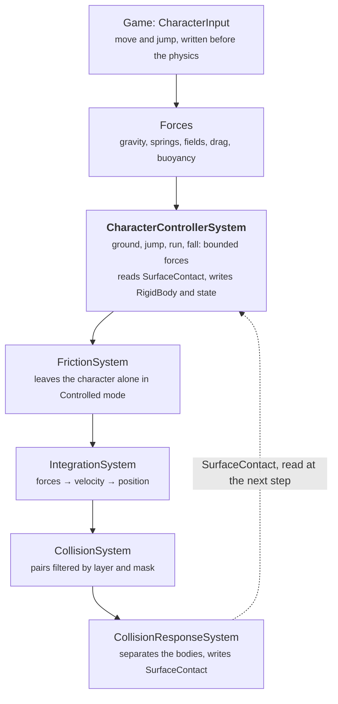

# Character

The physics of the player: how a character runs, jumps, stands on slopes and
moving platforms, pushes crates and walks through monsters. How each function
works inside is documented in the headers, as docstrings.

The player is an ordinary physics body with a mass. `CharacterControllerSystem`
steers it with bounded forces. So a light crate is pushed easily and a heavy one
slowly, a moving platform carries it, and an explosion throws it, with no
special code for any of these cases.

## Contents

1. [Overview](#overview)
2. [Components](#components)
   1. [Tuning](#tuning)
   2. [State the game can read](#state-the-game-can-read)
3. [Running and braking](#running-and-braking)
   1. [The controller is the grip](#the-controller-is-the-grip)
   2. [Slippery grounds](#slippery-grounds)
   3. [Pushing](#pushing)
4. [Jumping](#jumping)
   1. [When the jump happens](#when-the-jump-happens)
   2. [Jump speed](#jump-speed)
   3. [Variable jump and fall](#variable-jump-and-fall)
5. [The ground](#the-ground)
   1. [Slopes](#slopes)
   2. [Changes of ground](#changes-of-ground)
   3. [Moving platforms and conveyors](#moving-platforms-and-conveyors)
6. [Layers and masks](#layers-and-masks)
7. [Usage](#usage)
   1. [Knockback, explosion, rope: Physics mode](#knockback-explosion-rope-physics-mode)
   2. [Tuning tips](#tuning-tips)
8. [Known limits](#known-limits)
9. [Tests](#tests)
10. [Files](#files)

## Overview

The game only writes the intent, in `CharacterInput`: a direction in [-1, 1]
and the state of the jump button. The engine knows neither the keyboard nor
the gamepad. An enemy uses the same component, filled by its AI.

Two modes decide who moves the character:

- **Controlled** (default): the controller steers the velocity from the
  input, with a bounded acceleration.
- **Physics**: the controller lets go. Only forces and impacts move the body
  (knockback, explosion, rope). Control comes back after `physicsTimeLeft`,
  or when the game sets the mode back to `Controlled`.

Every unit is SI: m, m/s, m/s², s, N. The physics is tuned for a fixed step of
1/60 s (`Physics::Step`): the jump height and the stability depend on it.

One physics step, in the order `Physics::install` registers the systems:



The controller reads the ground found by the previous step's collision. It
adds its forces after the world's, so it can compensate them exactly.

## Components

A character is an entity with these components. Without `RigidBody`,
`CharacterController` or `CharacterInput`, or with a mass of 0,
`CharacterControllerSystem` ignores it.

| Component | Written by | Role |
| --- | --- | --- |
| [`RigidBody`](../../../Component/Physics/RigidBody.hpp) | the game, at creation | mass > 0 (70 kg in the demo). The system forces `fixedRotation = true`: the character stays upright when hit from the side. |
| [`CharacterController`](../../../Component/Physics/CharacterController.hpp) | the game (tuning), the system (`state`) | the tuning below, the mode, and the state computed every step |
| [`CharacterInput`](../../../Component/Physics/CharacterInput.hpp) | the game, every step | `move` in [-1, 1], and `jump`: whether the button is held, not whether it was just pressed |
| `Transform` + [`Collider`](../../../Component/Physics/Collider.hpp) | the game, at creation | the shape. Set `response = Collider::Response::Stop`: the character never bounces, and keeps its velocity along what it touches. |
| [`SurfaceContact`](../../../Component/Physics/SurfaceContact.hpp) | `CollisionResponseSystem` | the surface touched this step: normal, friction, velocity. Absent in the air. The controller reads it to know whether it stands on ground. |

### Tuning

Fields of `CharacterController`:

| Field | Default | Effect |
| --- | --- | --- |
| `maxSpeed` | 7 m/s | running speed at `move = ±1`, relative to the ground |
| `acceleration` | 70 m/s² | on the ground, 0 to 7 m/s in 0.1 s |
| `deceleration` | 90 m/s² | on the ground with no input, stops in 0.08 s |
| `airAcceleration` | 40 m/s² | control in the air |
| `airDeceleration` | 5 m/s² | in the air with no input: low, so a jump keeps its momentum |
| `fullGripFriction` | 0.4 | ground static µ from which the feet grip fully |
| `pushStrength` | 1000 N | strongest force on a body the character runs into |
| `jumpHeight` | 2.5 m | exact height of a full jump |
| `jumpCutFactor` | 0.5 | releasing jump while rising multiplies the upward speed by this. 1 disables it. |
| `fallGravityMultiplier` | 1.5 | gravity multiplier while falling: the fall is quicker than the rise |
| `maxFallSpeed` | 25 m/s | fastest fall, in both modes |
| `groundSnapDistance` | 0.3 m | how far down the ground is looked for after losing it without jumping. 0 disables it. |
| `coyoteTime` | 0.1 s | the character can still jump this long after walking off a ledge |
| `jumpBufferTime` | 0.1 s | a jump pressed up to this long before landing happens on landing |
| `maxGroundAngle` | 50° | steepest slope that counts as ground. Steeper is a wall. |

### State the game can read

The system rewrites `controller.state` every step. The game reads it for
animation, sound and effects:

- `grounded`: on ground, a surface flatter than `maxGroundAngle`.
- `landed`: touched the ground this step (landing sound, dust).
- `jumped`: jumped this step.
- `facing`: -1 or 1, the last direction asked for (sprite direction).
- `groundNormal`, `groundVelocity`, `groundFriction`: the current ground, or
  the last one.
- `timeSinceGrounded`, `timeSinceJumpPressed`: the coyote-time and
  jump-buffer timers.

## Running and braking

The controller never sets the velocity. It adds a force that brings the
velocity towards the target, by at most `acceleration × dt` per step. Since
the force is bounded, an explosion or a heavy crate still has its effect.

Each step, in Controlled mode:

1. **Axis**: along the ground (perpendicular to its normal), pointing right.
   In the air, the horizontal. The character runs up a slope without slowing
   down or taking off.
2. **Target velocity**: `ground velocity + move × maxSpeed`. Standing still on
   a moving platform, the character follows it.
3. **Predicted velocity**: the current velocity plus what the forces already
   added this step (gravity, wind, field) will give. The controller
   compensates them and reaches its target exactly, within its acceleration.
4. **Rate**: `acceleration` when the input goes the way of the change,
   `deceleration` otherwise (no input, or too fast). In the air:
   `airAcceleration` and `airDeceleration`.
5. **Force**: the change is clamped to `rate × dt`, then turned into a force:

```
F = m · clamp(v_target − v_predicted, −rate · dt, rate · dt) / dt
```

### The controller is the grip

A runner's feet do not slide: the ground's static friction is what pushes
them forward. So in Controlled mode the system sets the coefficients of the
`SurfaceContact` to 0 for the step, and `FrictionSystem` does not slow the
character down. Otherwise rough ground would slow it more than ice, the
opposite of real life. `CollisionResponseSystem` writes the real coefficients
again at the next step.

### Slippery grounds

The grip is only as good as the ground. Below `fullGripFriction`,
`acceleration` and `deceleration` are multiplied by `(µ / fullGripFriction)²`,
where µ is the combined static friction of the ground and the feet. Squared,
so the loss is slight on a slightly slippery ground and strong on ice.
Measured in the demo (zone 3):

| Ground | Speed after 0.5 s of running | Slide after letting go |
| --- | --- | --- |
| Rock | 7 m/s | 0.27 m |
| Ice | 3.94 m/s | 0.73 m |

### Pushing

When the character runs into a dynamic body it touched at the previous step
(within 60° of its direction), its acceleration is capped at
`pushStrength / mass`. The crate's mass and friction then decide. With the
defaults (1000 N, wood on wood):

| Crate | Result |
| --- | --- |
| 10 kg | pushed almost without slowing down: full speed in 0.6 s |
| 100 kg | pushed slowly: about 2.1 m in 1 s |
| 1000 kg | does not move: its static friction holds up to 4900 N |

## Jumping

A full jump raises the feet by exactly `jumpHeight`, whatever the gravity and
the step: 2.500 m measured in the demo for 2.5 m asked.

### When the jump happens

The game writes the state of the button in `CharacterInput::jump`. The system
detects the press itself (released at the previous step, held at this one).
The jump happens when both are true:

- **on the ground, or nearly**: `timeSinceGrounded ≤ coyoteTime`. The
  character can still jump 0.1 s after walking off a ledge.
- **recent press**: `timeSinceJumpPressed ≤ jumpBufferTime`. A press 0.1 s
  before landing is not lost.

After a jump both timers go to infinity: no second jump from the same ground,
and the press is used.

### Jump speed

The upward velocity is **set**, not added, and it is relative to the ground's
upward velocity. So a coyote jump while already falling rises as high, and a
jump from a lift starts from the lift's speed.

The continuous formula `v = √(2 g h)` is not enough. The integration
(semi-implicit Euler) lowers the velocity before each move, and the body peaks
about `v · dt / 2` short: 12 cm (5 %) for 2.5 m at 60 Hz.
`Physic::speedToReachHeightForStep` solves for the height reached in discrete
steps:

```
v = g·dt/2 + √((g·dt/2)² + 2·g·h)
```

The apex is never below `h`, and at most `g·dt² / 8` above (0.3 mm at 60 Hz):
the character always clears a ledge of the advertised height.

### Variable jump and fall

- **Short hop**: releasing jump while rising multiplies the upward speed by
  `jumpCutFactor`. With 0.5, the speed is halved and the remaining height
  quartered.
- **Quicker fall**: while falling in the air, gravity is multiplied by
  `fallGravityMultiplier`. With 1.5, the fall takes √1.5 times less time than
  the rise, and `jumpHeight` is unchanged.
- **Terminal speed**: the fall is capped at `maxFallSpeed`, in both modes.
  Keep it under the thinnest platform's thickness × 60 (60 m/s for 1 m at
  60 Hz): faster, a step could skip through it.

## The ground

The character stands on ground when its `SurfaceContact` exists and its
normal is within `maxGroundAngle` (50°) of the vertical. Steeper is a wall:
no running on it, no jumping from it.

`CollisionResponseSystem` keeps one surface per body: the one facing up the
most, then the one under the center. The choice does not depend on the order
the entities were created in.

### Slopes

- **Standing still on a slope**, the character does not slide. With no input,
  `deceleration` (90 m/s²) cancels gravity along the slope, 4.9 m/s² on 30°.
- **Running up or down**, the run follows the slope's axis, at `maxSpeed`
  along the slope, without ever leaving the ground.

### Changes of ground

At the top of a slope, the velocity still points up while the ground becomes
flat. Uncorrected, the character would take off as from a ramp. Two
mechanisms prevent it:

1. **Sticking to the new ground**: when the ground's normal changes from one
   step to the next, the part of the velocity leaving the new ground is
   removed. The character reaches the plateau at (7, 0) m/s.
2. **Ground snap**: when it loses the ground without jumping (top of a slope,
   small step down), the system sweeps its collider down by
   `groundSnapDistance` (0.3 m) and puts it back on the first ground found. A
   step deeper than that is a fall.

`groundSnapDistance` must exceed `maxSpeed × dt × tan(maxGroundAngle)`: 0.14 m
at 7 m/s, 60 Hz and 50°.

Both corrections apply only when the ground changes or is lost. A bounce pad
giving 6 m/s upwards on flat ground keeps its whole effect: about 1.8 m high.

### Moving platforms and conveyors

The target velocity and the jump are relative to `groundVelocity`, the
velocity of the surface. Standing still on a platform, the character follows
it: the gap measured in zone 4 of the demo is 0.000 m/s. Jumping off, it keeps
the platform's velocity, since `airDeceleration` is low.

## Layers and masks

Each `Collider` has a `layer` (the bits of what it is) and a `mask` (the bits
of what it touches). Two colliders touch only if each one accepts the other
(`Component::canCollide`):

```
canCollide(a, b) = (a.layer & b.mask) != 0 && (b.layer & a.mask) != 0
```

By default `layer = 1` and `mask = ~0u`: everything touches everything. The
ground and walls keep the default mask, so they accept every layer with no
setup. For a player to walk through monsters, one of the two only has to
refuse the other.

| Entity | `layer` | `mask` | Touches |
| --- | --- | --- | --- |
| Ground, walls, crates | `World` (default 1) | `~0u` | everything |
| Hero | `Hero` | `~Enemy` | ground, crates, not the monsters |
| Monster | `Enemy` | `~0u` | ground, crates (the hero refuses it) |

The `Layer` constants (1, 2, 4) are the demo's: each game defines its own, one
per bit. The filter applies wherever the character looks for what it touches:

- **`CollisionSystem`**: the pair is not tested, so no contact, no push, no
  `SurfaceContact`. The test costs two bitwise ANDs.
- **The ground snap**: the downward sweep skips refused colliders. The
  character never lands on a monster it walks through.

In the demo (zone 1), the hero walks through the monster up to the wall
(x = 0.40 m), and the monster does not move (0.000 m). A gameplay raycast,
such as the grappling hook, does not use this filter: pass it the mask
yourself, as `raycastScenery` does in the demo.

## Usage

Create the player, as `buildHero()` does in `demos/Showcase/ShowcaseDemo.cpp`:

```cpp
const ECS::Entity hero = world.spawnEntity();
world.addComponent(hero, Component::Transform{spawn, 0.f});

Component::RigidBody body;
body.mass = 70.f;
world.addComponent(hero, body);

Component::Collider collider;            // a 0.8 × 1.8 m box
collider.shape = Component::Collider::Box{{0.4f, 0.9f}};
collider.response = Component::Collider::Response::Stop;  // never bounces
collider.layer = Layer::Hero;
collider.mask = ~Layer::Enemy;          // walks through monsters
world.addComponent(hero, collider);

world.addComponent(hero, Component::CharacterController{});  // default tuning
world.addComponent(hero, Component::CharacterInput{});
```

The game's input system fills `CharacterInput` **before** the physics, every
fixed step. Add it before calling `Physics::install`: `SystemManager` runs
systems in the order they were added.

```cpp
systems.addSystem<PlayerInputSystem>(world);  // the game's: writes CharacterInput
Physics::install(world, systems);
systems.addSystem<AnimationSystem>(world);    // the game's: reads controller.state

systems.update(world, Physics::Step);         // 1/60 s, always
```

```cpp
input.move = right - left;   // -1, 0 or 1 on a keyboard, analog on a gamepad
input.jump = jumpHeld;       // the button's state, not its press
```

### Knockback, explosion, rope: Physics mode

To let physics alone move the character, call `handToPhysics(duration)` and
apply the impulse as usual:

```cpp
controller.handToPhysics(0.3f);       // knockback: control back in 0.3 s
body.velocity += knockback;

controller.handToPhysics(0.f);        // rope: until the game says otherwise
controller.mode = Component::CharacterController::Mode::Controlled;  // released
```

In Physics mode only the fall cap applies. The ground's friction is back: a
thrown character slides to a stop over `v² / (2 µ g)`.

### Tuning tips

- **Snappier**: raise `acceleration` and `deceleration`. The defaults already
  reach full speed in 0.1 s.
- **Heavier in the air**: lower `airAcceleration`, or raise
  `fallGravityMultiplier` towards 2.
- **No variable jump**: `jumpCutFactor = 1`.
- **An enemy**: the same components, with a `CharacterInput` filled by its AI
  and a lower `maxSpeed`.

## Known limits

- **Fixed step required**: the jump height, the ground snap and the stability
  are computed for a constant step. The jump stays exact at 30 or 144 Hz if
  the step is constant, but if `dt` varies from one step to the next, it no
  longer reaches `jumpHeight`.
- **Very heavy crate**: a 400 kg crate, whose static friction (1962 N) exceeds
  `pushStrength` (1000 N), should not move. Pushed for 1.5 s, it still moves
  3.2 cm. This is one of the two known limits of the demo's self-test.
- **No continuous detection**: at `maxFallSpeed`, one step moves the character
  0.42 m. A platform thinner than that can be skipped.
- **One surface**: standing across two grounds, the character sees only one,
  the one under its center.
- **Not provided yet**: wall jump, wall slide, ladders, crouching. These are
  behaviours to build on `state` and Physics mode.

## Tests

The tests live in
[TestCharacterControllerSystem.cpp](../../../../../tests/Engine/System/Physics/Character/TestCharacterControllerSystem.cpp),
run by the `tests_engine` target. Each group checks values computed by hand,
not only the direction of a change.

| Group | What it guarantees |
| --- | --- |
| `test_standing_and_running` | 7 m/s reached in 6 steps (0.1 s), stopped in 5 steps |
| `test_jump` | apex never below `jumpHeight`, at most `g·dt² / 8` above, at 30, 60 and 144 steps per second; short hop at a quarter of the height; fall √1.5 times quicker |
| `test_forgiveness` | coyote time and jump buffer; a coyote jump while falling rises as high; a wall is not ground |
| `test_air_and_wind` | air control; a 28.6 m/s² wind is compensated, a 143 m/s² one wins |
| `test_slopes` | standing still on 30° without sliding; running at `maxSpeed` along the slope, never in the air; 60° is a wall |
| `test_junctions` | over the top of a slope without taking off, at every speed; bounce pad kept; a step too deep is a fall |
| `test_world` | pushing 10, 100 and 1000 kg; moving platforms |
| `test_physics_mode` | knockback, slide of `v² / (2 µ g)`, control coming back; never tipped over |
| `test_slippery_ground` | acceleration and braking reduced on ice, whole from `fullGripFriction` up |
| `test_character_layers` | walking through a monster without pushing it; never landing on it |

The demo's self-test also measures the character in a real level:

```sh
cmake --build cmake-build-demos --target demo_showcase
SDL_VIDEO_DRIVER=offscreen ./cmake-build-demos/demos/demo_showcase --selftest
```

## Files

| File | Content |
| --- | --- |
| [CharacterControllerSystem.hpp](CharacterControllerSystem.hpp) | the system: ground, snap, jump, run, fall |
| [CharacterController.hpp](../../../Component/Physics/CharacterController.hpp) | tuning, mode, `handToPhysics`, state |
| [CharacterInput.hpp](../../../Component/Physics/CharacterInput.hpp) | the intent written by the game |
| [SurfaceContact.hpp](../../../Component/Physics/SurfaceContact.hpp) | the surface touched, written by `CollisionResponseSystem` |
| [Kinematics.hpp](../../../Common/Physic/Kinematics.hpp) | `speedToReachHeightForStep` |
